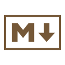

<br/>
<div align="center">
<a href="https://github.com/user/repo">

</a>
<h3 align="center">UI</h3>
<p align="center">
React UI library for my personal projects.
<br/>
<br/>
</div>

Table of Contents

- [About The Project](#about-the-project)
  - [Built With](#built-with)
    - [Icons](#icons)
- [Getting Started](#getting-started)
  - [Prerequisites](#prerequisites)
  - [Installation](#installation)
- [Usage](#usage)

## About The Project

About the project, include images here too.

### Built With

This project was built with the following technologies:

- 
- 

#### Icons

- [Tabler](https://icon-sets.iconify.design/tabler/)

## Getting Started

Instructions of setting up project on your local machine.

### Prerequisites

Describe prerequisites and how to complete them, this example we're installing nodemon. To install nodemon do the following:

- Install Nodemon:
  ```sh
  npm install -g nodemon
  ```

### Installation

1. **Clone the repository**

   ```sh
   git clone --recurse-submodules https://github.com/venoblin/scripts
   ```

## Usage

Put usage examples here
